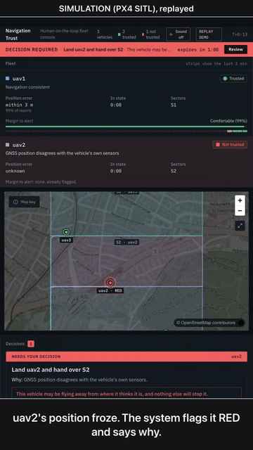
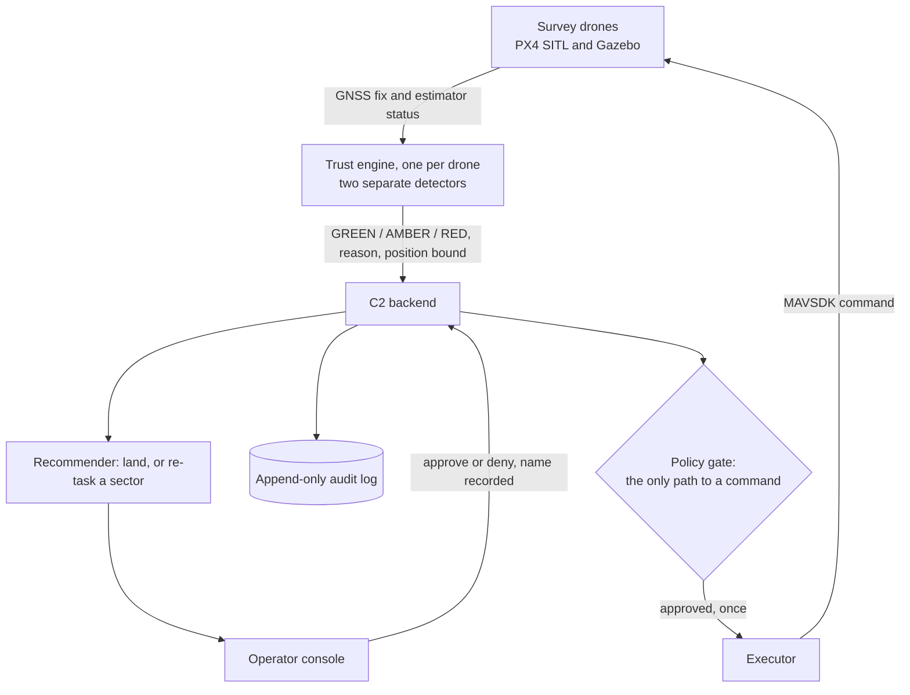
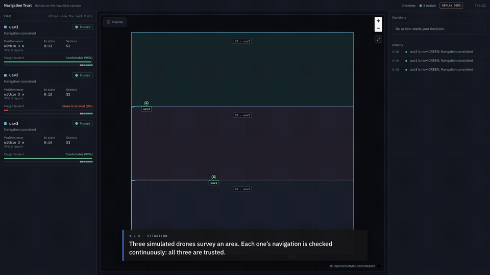
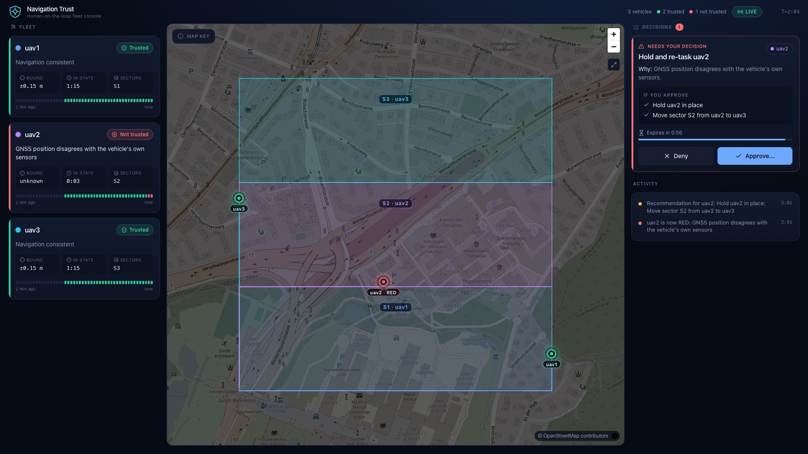

# nav-trust-c2

[](https://github.com/Telschow/nav-trust-c2/actions/workflows/ci.yml)
[](https://github.com/Telschow/nav-trust-c2/actions/workflows/codeql.yml)
[](https://telschow.github.io/nav-trust-c2/)
[](LICENSE)

**Does the operator know which drone's position to trust, and what to do about it?**

<p align="center"></p>

*The real console in the replay demo: recorded trust data, synthetic positions, no simulator running. [The full 38 s clip with captions](docs/media/vertical/clip.mp4).*

<!-- summary-start -->
## In 60 seconds

**Problem.** A drone that loses GNSS, or whose position has frozen, keeps flying on a position
that is wrong. A person supervising several drones has to learn which one, how wrong, and what to
do, and no vehicle may be commanded without that person's approval.

**What it does.** Two independent detectors watch each simulated vehicle (GNSS availability, and
agreement with the vehicle's own sensors). The console shows per vehicle a trust state (GREEN,
AMBER, RED), the reason, and a position error with its measured coverage. It recommends landing,
re-tasking a lost vehicle's sector, and nothing else. Nothing executes without a recorded
operator approval; one gate is the only path to a command, and a test enforces it.

**Evidence, all in simulation (PX4 SITL and Gazebo, ground truth from the simulator).**

- GNSS loss was detected in 1.0 to 1.4 s in 12 runs; a frozen position in 3.0 to 4.5 s. No alert
  in 9 nominal runs. The frozen-position range spans three flight speeds (5, 10 and 12 m/s), 2 to 3
  runs each.
- The displayed bound, within 3 m, held in 100% of 4,040 reports on the data it was tuned on and
  in 99.72% of 5,308 reports on an independent set. The first version, taken from the
  estimator's own accuracy figure, held in 30.8%.
- A frozen GPS position does not stall the vehicle, it flies away (5.3 km at the 220 s cut-off,
  one run). Only LAND ended the flight in a controlled stop, so that is what is recommended (one run per
  action).
- With one of three vehicles lost, the area covered was 100% when the operator approved the
  re-task and 87% when the operator denied it (3 runs each, scripted operator).
- Held-out validation: 7 of 8 pre-declared expectations met. The one that was not is reported,
  not excluded: [docs/validation/heldout-report.md](docs/validation/heldout-report.md).

**What is not shown.** Real hardware, real interference, a slow gradual position drift (the
simulator cannot inject one: PX4 offers GPS failure `off`, `stuck` and `wrong` only), or a
usability result: two people did not act on the decision unaided, the console was then redesigned,
and that has not been re-tested ([findings](docs/usability/findings-2026-10.md)). Targets in the
documents are proposals.

**Demo video (about 3 minutes):** https://youtu.be/L7DrhOYMQ5A. A one-minute captioned version is
on the [project page](https://telschow.github.io/nav-trust-c2/).

**New to the field?** A two-minute interactive explainer, no background needed:
[Which dot can you trust?](https://telschow.github.io/nav-trust-c2/media/explainer.html)

**How it was built, including the mistakes:** [docs/how-this-was-built.md](docs/how-this-was-built.md).

## How it works



1. **Detect.** Each drone's navigation is checked twice a second by two separate detectors
   ([ADR 0001](docs/adr/0001-separate-loss-and-consistency-detectors.md)): is GNSS available, and
   does the GNSS position agree with the drone's own sensors.
2. **Explain.** The console shows a trust state, the reason in plain words and how far off the
   position may be.
3. **Recommend, then wait.** The backend proposes one action and lists exactly what approving will
   do. A person approves or denies; the decision and the name go to an append-only log.
4. **Execute through one gate.** Only an approved recommendation, and only once, reaches a vehicle.
   PX4's own failsafes stay outside the C2 and act on their own.



*Replay demo at double speed; map tiles left out of this recording.*
<!-- summary-end -->

## Product and programme documents

The product and delivery side of the project, written before and during the build:

| Document | What it answers |
|---|---|
| [Concept of operations](docs/product/CONOPS.md) | Who supervises the drones, in which mission, under which assumptions |
| [PR/FAQ](docs/product/PRFAQ.md) | The product pitch and the hard questions, written against the planned end date |
| [Personas](docs/product/personas.md) | Who the console is for (hypotheses, tested in the usability sessions) |
| [Requirements](docs/product/requirements.md) and [trace](docs/product/trace.csv) | What the system must do, each requirement traced to its evidence, checked by a test |
| [Programme plan](docs/programme/plan.md) | Milestones, actuals and the honest re-plan |
| [RAID log](docs/programme/risks.md) | Risks, assumptions, issues and dependencies, each with what reduces it |
| [Usability findings](docs/usability/findings-2026-10.md) | What failed in the first operator test and what changed |

## Scope and ethics guardrails

- Simulation only. Unclassified, public sources only.
- Mission framing is search-and-rescue and area survey.
- No weapons, no targeting, no effectors, no real platform parameters, no swarm attack behaviour.
- The operator approves vehicle commands. Only PX4's own failsafes act without approval today.
  A contingency approved before the mission (ADR 0004, LAND only) is partly built, in simulation only: the
  backend records the approval, a vehicle pulls the policy bound to its mission and vehicle
  before launch, and a vehicle-side monitor decides within it (unit tested, and replayed to
  confirm it never acts in the nominal, jamming, stuck, wrong-fix and link-only recordings). In 3
  of 3 simulator runs under an approval made at the backend (`sim/record_onboard_approved_runs.sh`),
  the vehicle landed itself 5.0 s after the link was cut and the backend accepted its report once
  the link was back. The link signal is the cut relay's state and PX4 entering LAND is not a
  measured touchdown; the recordings are in
  `eval/lost_link/onboard-approved`. Reports are not authenticated (ADR 0004).

## Limits of the approval path

A research prototype for one backend process on a trusted machine, not a deployment or a safety
case.

- **The operator name is a label.** There is no login: the backend records whatever name the
  client sends. The server binds to `127.0.0.1` by default; do not expose it to a network you
  do not trust.
- **A recommendation can be approved during an outage.** A changed trust state or reason
  closes the open recommendation, and so do trust reports that stop while positions keep the
  link up (after the 2 s link timeout, a proposal). But while nothing is heard from the vehicle
  at all, a recommendation raised before the outage stays open and can be approved and sent
  (ADR 0004); with the modelled link it is not acknowledged and not resent.
- **Sent, acknowledged and done are different.** An acknowledgement means the vehicle accepted
  the command, not that it landed. A command that times out is not resent, and whether it
  arrived is unknown.
- **The audit check is linkage, not tamper evidence.** The verifier checks that every sent
  command follows an approval of the same recommendation, vehicle and action. Edits made
  directly to the SQLite file are not detected.
- **Onboard reports are self-reports.** They are checked against the approved policy, not
  authenticated, and the vehicle's retry queue is lost if its process restarts.

## Non-goals

Real hardware flight, swarming algorithms, computer vision, learned components, datalink
encryption modelling, any targeting or effector logic.

## Quick start

Checks (no simulator needed). Python 3.12; Node 22 or newer only for the console:

```
python -m venv .venv && source .venv/bin/activate
pip install -e ".[dev,sim,c2]"
make check
```

The console demo (no simulator, no Docker): `make demo`, then open http://127.0.0.1:8000. About 15
seconds after it starts, uav2 turns RED and a decision appears. Other scenarios:
`make demo-run DEMO_SCENARIO=outage` (a vehicle loses GNSS and PX4 lands it) or `both` (two
alerts at once). Stop it with Ctrl-C. Details under "Operator console" below.

Simulator (Docker; the first image build compiles PX4, needs about 8 GiB for the Docker VM and 20 GB of disk):

```
make sim-build
make sim-up        # headless PX4 SITL + Gazebo, vehicle 1 on udp 14541
make fly           # lawnmower survey over 1 x 1 km, telemetry to logs/*.jsonl
make sim-down
```

The image pins PX4 to a `main` commit (see `sim/docker/Dockerfile`), not a release, because GPS
failure injection for Gazebo does not exist in v1.17.0. All recordings were made with it.

## Operator console



A dark operations console: a row per vehicle (trust state as a shape, a word and a colour,
plain-language reason, position error, time in state, assigned and flown sectors, margin to alert,
a two-minute trust strip), a map with the survey sectors coloured by the vehicle that owns them,
and a decision queue where each recommendation lists exactly what approving will do and counts
down to its expiry. While any decision waits, a red band across the top names the most urgent one
and the time left.

The screenshot is the **replay demo** (`make demo`: recorded trust data from a simulated frozen
GPS position, synthetic positions, labelled `REPLAY DEMO` in the header). uav2 turned RED, a red
band across the top says a decision is required, and the console recommends landing uav2 and
moving its sector to uav1. Nothing has been sent: the decision waits for the operator. The
healthy vehicles show "within 3 m" (a bound that held in 99% of reports, measured against
simulator ground truth) and their margin before an alert. The three-vehicle runs with live PX4
vehicles are in [eval/fleet/results.md](eval/fleet/results.md).

Run the same thing yourself without the simulator: `make demo`, then open http://127.0.0.1:8000. That replays
**recorded** trust data with **synthetic** positions, and the console says `REPLAY DEMO` in the
header whenever the data is not live. Map tiles are OpenStreetMap (internet needed; attribution
is shown on the map). The tiles come from OpenStreetMap's public server, whose
[tile usage policy](https://operations.osmfoundation.org/policies/tiles/) allows light use such
as this demo and not bulk or production use. For anything heavier, point the map style in
`console/src/components/MapView.tsx` at your own tile source.

## Results

The evaluation (time to detect, false alerts, time spent GREEN while the position was actually
wrong, error at the alert, mission completion, operator interruptions) is generated from
recorded simulator runs with ground truth: [eval/results.md](eval/results.md). CI recomputes it
and fails if it differs. The scenarios are in [scenarios/](scenarios/); `make record-all`
re-records them (simulator needed, about 1.5 hours) and `make eval` regenerates the table.

Fleet-level mission completion (three vehicles, one lost, a scripted operator) is in
[eval/fleet/results.md](eval/fleet/results.md): in simulation the re-task brought the area covered
from 87% to 100%. `make record-fleet` re-records it (about 80 minutes) and `make eval-fleet`
regenerates the table.

## How this was built

This project (including its code, tests and documentation) was supported by different local and cloud-hosted LLMs. Every design & architecture decision, the scope and goals of the project and its requirements and limitations was defined by me (aka the maintainer). You can find further information in 
[docs/how-this-was-built.md](docs/how-this-was-built.md).

## Acknowledgements

Built on [PX4](https://px4.io) (BSD-3), [Gazebo](https://gazebosim.org), [MAVSDK](https://mavsdk.mavlink.io),
[MapLibre GL JS](https://maplibre.org) (BSD-3), map data from
[OpenStreetMap contributors](https://www.openstreetmap.org/copyright) (ODbL) and the IBM Plex
fonts (SIL Open Font License 1.1). `console/DESIGN.md` is adapted from
[VoltAgent/awesome-design-md](https://github.com/VoltAgent/awesome-design-md) (MIT).

## Related work

[contested-nav](https://github.com/Telschow/contested-nav) is a separate project by the same
author: an error-state Kalman filter and a calibration harness that checks whether a filter is
right about how wrong it is. It found a filter that is accurate but confidently wrong, the same
failure this repository's first position bound had. The two share no code.

## Layout

See `CLAUDE.md`.
