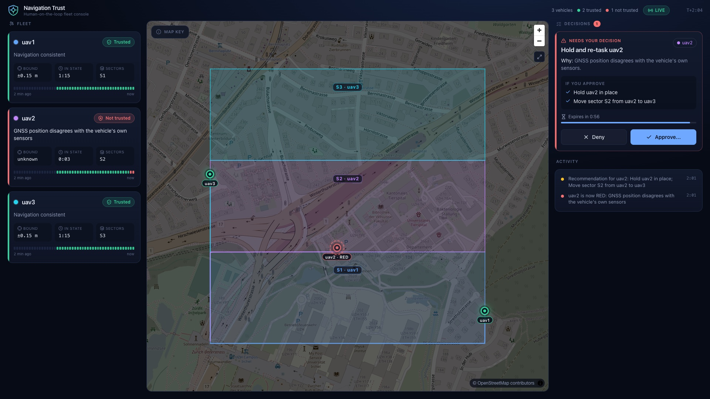

# nav-trust-c2

Human-on-the-loop mission control console for a small team of simulated drones. It detects GNSS
degradation, tells the operator how much to trust each vehicle's position, and recommends (never
executes without approval) re-tasking, hold or return-to-launch.

**Status: milestone M0 (skeleton). No trust engine, no console yet.** Results table, demo video
and the 60-second summary come with later milestones.

## Scope and ethics guardrails

- Simulation only. Unclassified, public sources only.
- Mission framing is search-and-rescue and area survey.
- No weapons, no targeting, no effectors, no real platform parameters, no swarm attack behaviour.
- The operator always approves vehicle commands. Only PX4's own failsafes act without approval.

## Non-goals

Real hardware flight, swarming algorithms, computer vision, learned components, datalink
encryption modelling, any targeting or effector logic.

## Quick start

Checks (no simulator needed):

```
pip install -e ".[dev,sim]"
make check
```

Simulator (Docker; the first image build compiles PX4, needs about 8 GiB for the Docker VM and 20 GB of disk):

```
make sim-build
make sim-up        # headless PX4 SITL + Gazebo, vehicle 1 on udp 14541
make fly           # lawnmower survey over 1 x 1 km, telemetry to logs/*.jsonl
make sim-down
```

Caveat: the Docker image and the survey flight were written against the PX4 v1.17.0 sources but
have not yet been run end to end. M0 is not done until they have.

## Operator console



A dark operations-room console: a card per vehicle (trust state, plain-language reason, position
bound, time in state, assigned sectors, a two-minute trust strip), a map with the survey sectors
coloured by the vehicle that owns them, and a decision queue where each recommendation lists
exactly what approving will do and counts down to its expiry.

The screenshot is a **live run** of three simulated PX4 vehicles: a frozen-GPS-position fault was
injected on uav2, its trust turned RED, and the console recommends holding it and moving its
sector. Approving in the console sent the commands to the vehicles (uav2 went to HOLD, uav3 got
the extra sector).

Try it without the simulator: `make demo`, then open http://127.0.0.1:8000. That replays
**recorded** trust data with **synthetic** positions, and the console says `REPLAY DEMO` in the
header whenever the data is not live. Map tiles are OpenStreetMap (internet needed; attribution
is shown on the map).

## Results

The evaluation (time to detect, false alerts, time spent GREEN while the position was actually
wrong, error at the alert, mission completion, operator interruptions) is generated from
recorded simulator runs with ground truth: [eval/results.md](eval/results.md). CI recomputes it
and fails if it differs. The scenarios are in [scenarios/](scenarios/); `make record-all`
re-records them (simulator needed, about 1.5 hours) and `make eval` regenerates the table.

## How this was built

_To be written by the maintainer: which parts were written by hand and which with AI assistance._

## Layout

See `CLAUDE.md`.
